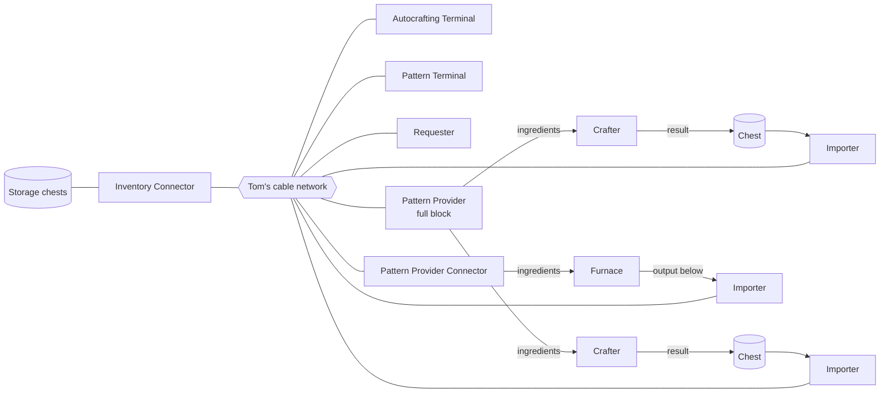

# Tom's Storage Autocrafting (Fabric 26.3)

Unofficial addon for [Tom's Simple Storage](https://modrinth.com/mod/toms-storage) (26.3-2.12.2, Fabric) that adds AE2-style autocrafting.
All text is translatable (`assets/tsautocraft/lang/*.json`); English and German are included.

Download: [Modrinth](https://modrinth.com/mod/toms-storage-autocrafting) · [CurseForge](https://www.curseforge.com/minecraft/mc-mods/toms-storage-autocrafting)

## Blocks & items

| Block / item                                | What it does                                                                                                                                                    |
|---------------------------------------------|-----------------------------------------------------------------------------------------------------------------------------------------------------------------|
| **Pattern Provider**                        | Full block, no front. Holds 9 patterns (up to 36 with Capacity Upgrades) and supplies **every** crafter / machine around it, one after the other.               |
| **Pattern Provider Connector** (+ Framed)   | Cable-connector shape with a front: supplies only the machine it faces. Convert between both in a crafting grid.                                                |
| **Pattern Terminal**                        | Tom's storage terminal plus a pattern encoder (crafting, processing, smelting, fluid and modes of other mods).                                                  |
| **Autocrafting Terminal**                   | Lists craftable items, accepts requests, shows and manages the jobs of the whole network.                                                                       |
| **Requester**                               | Keeps up to 6 items at a target amount and crafts more when the stock drops.                                                                                    |
| **Exporter** (+ Framed)                     | Pushes filtered items from the network into the inventory it faces. No filter: does nothing.                                                                    |
| **Importer** (+ Framed)                     | Pulls items from the inventory it faces into the network. No filter: everything.                                                                                |
| **Crafting Emitter**                        | Redstone signal on all sides: stock below / above an amount, or "craft" mode (makes the item craftable, signal while a job needs it, e.g. to switch a farm on). |
| **Directional Crafting Emitter** (+ Framed) | Same, in cable-connector shape: the signal only goes out of its front. Convert between both in a crafting grid.                                                 |
| **Blank / Encoded Pattern**                 | Put an encoded pattern into a crafting grid to wipe it. Rename patterns in an anvil; re-encoding keeps the name.                                                |
| **Upgrades**                                | Capacity, Speed, Stack, Crafting, Redstone (see below).                                                                                                         |

Exporter, Importer, the Pattern Provider Connector and the Directional Crafting Emitter use the shape of Tom's Inventory Cable Connector. **Framed** variants are
full blocks that can be painted with Tom's Paint Kit and scraped clean with an axe, like Tom's framed cables (recipe: 4 sticks
around the block; framed block + water bucket turns it back).

All blocks keep an **anvil name**: it becomes the GUI title, shows in Jade and in the job status, and stays on the dropped block.

## Setup



* All addon blocks connect to Tom's network like cables. Blocks with a front (connectors, exporter, importer, directional
  emitter) do not connect through it; placement: click on the target, the front then faces it.
* The full-block Pattern Provider never delivers into cables or other network blocks, only into machines around it.
* **Results do not come back automatically.** The crafter drops its result in front of itself: put a chest there and pull it
  into the network with an Importer (the Importer also tells the jobs that their results arrived).
* **Do not place machines or crafters directly next to storage chests.** Tom's Inventory Connector picks up every touching
  inventory as storage. Keep a gap or exclude it with Tom's Inventory Configurator.

### Patterns

| Mode                 | Encoding                                                                                                                       | Delivery                                                                                                      |
|----------------------|--------------------------------------------------------------------------------------------------------------------------------|---------------------------------------------------------------------------------------------------------------|
| **Crafting**         | 3×3 grid = crafter slots, result from the recipe. Optional **substitutes** (e.g. any planks), Shift shows them in the tooltip. | Fills a `minecraft:crafter` exactly in this layout (moved to enabled slots if needed).                        |
| **Processing**       | Free amounts (click with stack = full amount, right click ±1), outputs by hand.                                                | Inserts everything at once, only if all fits. Blocking mode waits until no ingredient is left in the machine. |
| **Smelting**         | First grid item, result from the furnace recipe.                                                                               | Straight into the input slot of a furnace / blast furnace / smoker.                                           |
| **Fluid processing** | Like processing; filled containers (water bucket, potion, mod tanks...) are fluid inputs.                                      | Empties the containers into the machine's tank, the empty containers go back into the network.                |

JEI / REI "+" fills the Pattern Terminal grid, encodes directly into a Pattern Provider, or sets a Requester entry.

How a filled crafter crafts is set by `crafterTrigger` in the config: your own redstone circuit (default), a direct block tick,
or a redstone pulse from the provider. With the full-block provider every crafter has its own cooldown, and a pulse only
reaches the crafter that was just filled.

### Fluids

Tom's network stores items only, so fluids travel as filled containers. A fluid processing pattern empties them into the
machine; for fluid results, put an Importer with the filled container as filter (e.g. a lava bucket) on the machine's tank:
it takes matching empty containers from the network, fills them and stores the result.

### Requesting & jobs

* Request in the Autocrafting Terminal, or right in any of Tom's terminals: craftable items show a green **+** (amount 0 if
  none is stored); click (or Ctrl+click) opens the request screen with the material list. Missing items? "Craft N" offers the
  largest amount that works right now.
* Intermediates are planned recursively; stock and surplus (e.g. 4 planks instead of 1) are reused. Jobs **reserve** their
  raw materials, so other jobs and Exporters do not take them.
* The job list shows all jobs of the network. Hover a job: every step with its progress and why it is stuck (missing item
  with have/need per craft, provider busy at x/y/z or by name, no machine, ...). Per job:
  * **↑ · ↓** priority (high / normal / low): higher priority jobs get free providers first.
  * **Ⅱ / ▶** pause / resume: a paused job frees its reserved items.
  * **✕** cancel.
* Tom's (Advanced) Wireless Terminal also opens the Autocrafting Terminal and the Pattern Terminal from afar.

### Requester, Exporter, Importer

* **Requester**: item + target amount per row; below it a job starts for the difference (at most `requesterMaxBatch` per job).
* **Filters** (Exporter / Importer): plain items are ghosts (only a copy, nothing is used up); Tom's filter items (item, tag,
  polymorphic filter) go in as real items and drop when the block is broken. Shift click and JEI/REI drag work too.
* **Mode button** (left of the filter grid): **round robin**, **priority** (first filter / slot that works), **random**,
  **blacklist** (Importer: everything except the filtered items).
* **Exporter + Crafting Upgrade**: a plain item filter that is not in storage is crafted (as much as fits into the target).

### Upgrades

Upgrades sit in the panel right of the GUI; several of the same kind can share one slot.

| Upgrade      | Pattern Provider                                       | Autocrafting Terminal    | Exporter / Importer                                                                    |
|--------------|--------------------------------------------------------|--------------------------|----------------------------------------------------------------------------------------|
| **Capacity** | +9 pattern slots (max 3)                               | +8 parallel jobs (max 8) | –                                                                                      |
| **Speed**    | +1 delivery per tick, shorter crafter cooldown (max 4) | –                        | halves the interval (max 4)                                                            |
| **Stack**    | 4× crafts per delivery, up to 64 (max 3)               | –                        | 4× items per operation, up to a stack (max 3)                                          |
| **Crafting** | –                                                      | –                        | Exporter: crafts missing filter items                                                  |
| **Redstone** | redstone pulse to the machine after every delivery     | –                        | works only with signal / only without signal / every pulse toggles (button in the GUI) |

## Compatibility

* **JEI** and **REI**: recipe transfer and ghost drag (REI is untested in game). EMI and WTHIT have no 26.3 build yet.
* **Jade**: status of providers (patterns, machines, blocking), terminals (jobs), requesters, emitters and exporters.
* **Mod Menu**: config screen (Cloth Config ships with Tom's Storage).

## Configuration

`config/tsautocraft.json` or the Mod Menu screen: crafter trigger, crafter timings, jobs per terminal, largest request,
job timeouts, requester and Importer/Exporter timings, craftable list refresh. In singleplayer changes in the screen apply right
away; a dedicated server reads the file at startup.

## Datapacks

* **Machine profiles** `data/<namespace>/tsautocraft/machines/*.json`: how the provider feeds a machine with processing patterns.
  ```json
  { "blocks": ["minecraft:brewing_stand", "#c:machines"], "sides": ["north", "up"], "redstone_pulse": 2, "blocking": true }
  ```
  `sides`: faces of the machine to insert through, tried in this order per stack; `redstone_pulse`: pulse after a delivery;
  `blocking`: force blocking mode on/off. A brewing stand profile is built in. `/reload` applies changes.
* **Item tags**: `#tsautocraft:not_autocraftable` (patterns with such an output are ignored), `#tsautocraft:no_substitute`
  (never stored as a substitute).

## API (for other mods)

Everything in `eu.sytxlabs.tsautocraft.api` is public API (`TsAutocraftApi.VERSION`); `gradlew build` also produces an
`-api.jar` to compile against.

* `PatternModes` / `PatternMode`: new pattern kinds (encoding, delivery, JEI/REI recipe matching).
* `IOModes` / `IOMode`: new Exporter/Importer modes.
* `CraftingProvider`, `JobOwner`: own blocks that run crafts or own jobs (found automatically on Tom's cable network).
* `CraftingEvents`: `PLAN_CREATED`, `JOB_STARTED`, `STEP_DISPATCHED`, `JOB_FINISHED`.
* `Upgrades`: own upgrade items for our blocks (with a maximum per block), `UpgradeHost` to read them.
* `MachineProfiles`: machine profiles in code.
* `PlannerHooks`: pattern order for the same output, craftable and substitute filters.
* `TsAutocraftApi`: craftables, jobs, request and missing items of a network.

## Building

Requires **JDK 25**.

```
gradlew build          # -> build/libs/tsautocraft-fabric-26.3-<version>.jar (+ -api.jar, -sources.jar)
gradlew runClient      # test client with Tom's Storage, Fabric API, JEI and Jade
                       # (-PnoJei, -PnoJade leave them out, -PwithModMenu adds Mod Menu)
gradlew plannerTest    # tests the crafting planner without Minecraft
```

In IntelliJ: open the folder, import the Gradle project, set the project SDK to 25.

## Known limits

* No crafting CPUs or byte limits; parallel jobs are limited per Autocrafting Terminal (config + Capacity Upgrades).
* Without Importer reports, a job counts as done once the requested amount has arrived in the network, or after a timeout.
* Fluids only as filled containers (Tom's network has no fluid storage).
